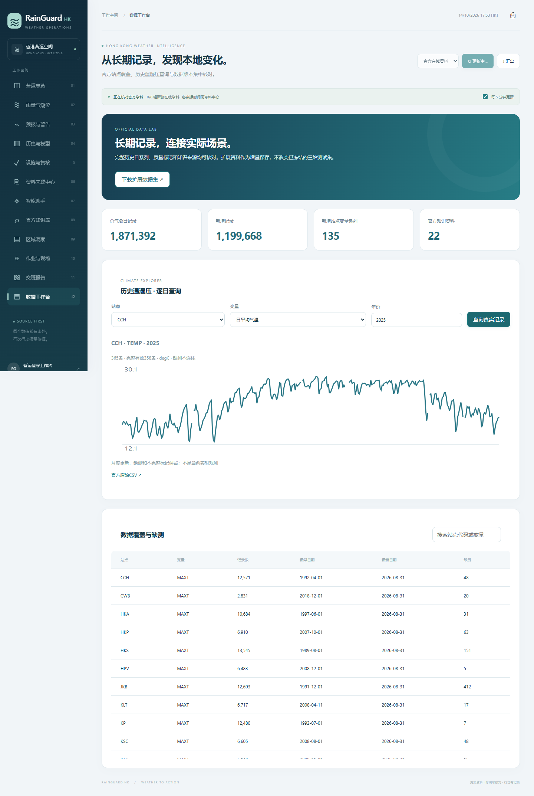
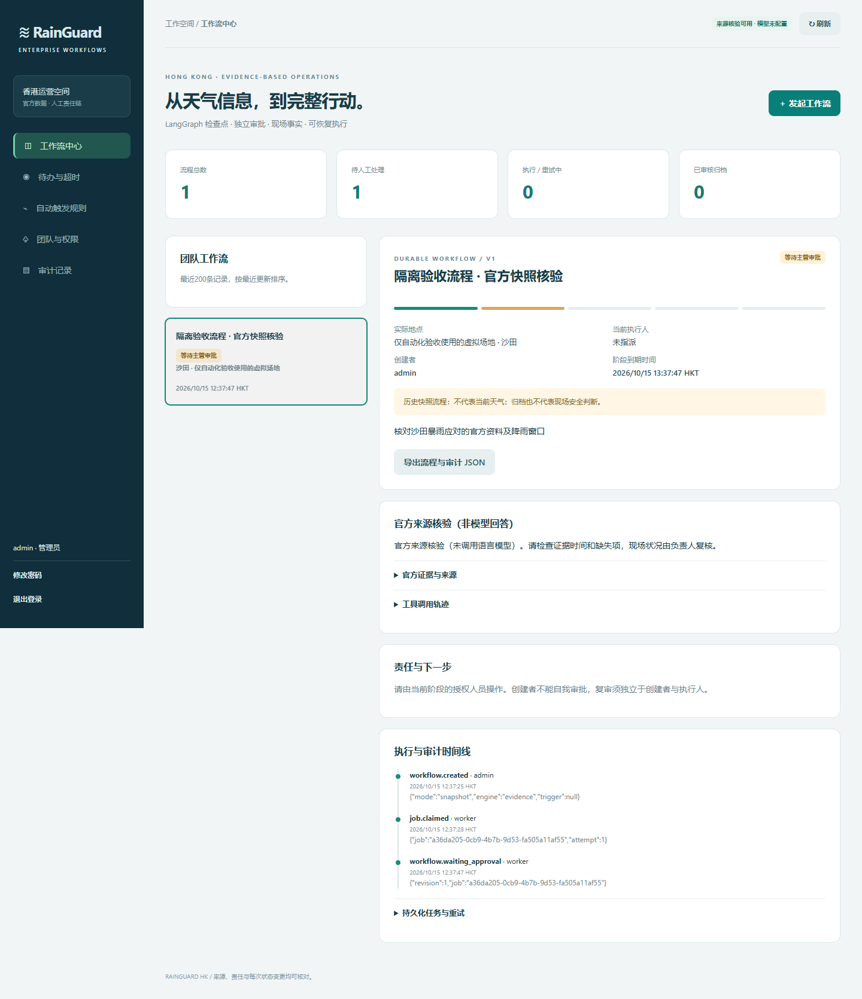

# RainGuard HK

香港本地天气决策支持与降雨分类实验平台，SDSC6004 小组课程项目。界面使用简体中文，观测和知识资料来自香港天文台、渠务署及劳工处。

当前版本提供 12 个工作页面，涵盖观测、官方预报与警告、知识检索、DeepSeek 助手、地区比较、作业窗口、设施复核、现场记录、历史高雨量检索和交班报告。它是可运行的课程应用原型；现场业务记录目前保存在各自浏览器中，可选启用服务端 SQLite 共享设施、工单与现场记录；个人对话和自导入资料仍仅在本机。

## v0.3.0 新增

新增 1,199,668 条官方温湿压日记录，总量 1,871,392 条；知识库扩展到 22 份官方资料。Agent 增加六个真实工具、执行轨迹和人工确认草稿；新增数据工作台及桌面/手机布局优化。详见 [v0.3.0说明](docs/V0_3_UPGRADE.md)。

[获取新版与扩展数据](https://github.com/Fan-Xuyang/RainGuard-HK-C6004/releases/tag/v0.3.0)；核心冻结数据包仍位于v0.1.0，不改变原实验测试集。

## 五分钟启动

需要 Node.js 22.13 或更新版本。**不配置模型密钥也可以运行天气页面和知识检索**。

```bash
git clone https://github.com/Fan-Xuyang/RainGuard-HK-C6004.git
cd RainGuard-HK-C6004
npm ci
npm start
```

打开 <http://localhost:8095>。从页面刷新官方数据；接口不可用时页面会显示错误或带日期的历史快照，不能将旧快照当作当前观测。

如需 AI 回答，将 `.env.example` 复制为 `.env.local`，在本机填入自己的 `DEEPSEEK_API_KEY`，然后重启服务。密钥只由服务端读取。仓库不包含密钥；不要在 Issues、PR、截图或前端文件中粘贴密钥。模型名称使用 `DEEPSEEK_MODEL` 配置，示例保留项目此前验证使用的值；如账户支持的模型变化，应按 DeepSeek 当前接口配置调整。

## 完整真实数据集

**[下载 v0.1.0 完整数据包](https://github.com/Fan-Xuyang/RainGuard-HK-C6004/releases/tag/v0.1.0)**，或运行：

```bash
python scripts/download_dataset.py
python scripts/download_dataset.py --extended
```

下载工具验证 SHA-256，再解压到 `datasets/RainGuard_HK_Dataset/`。完整 SQLite、全量历史 CSV、原文和训练特征放在 Release，避免大型数据文件进入每次代码提交。仓库保留可运行网站需要的三站数据与页面快照。

| 数据内容 | 本次快照规模 |
|---|---:|
| 全部可下载历史日雨量站 | 25 站 |
| 日雨量记录 | 293,267 条 |
| 全部气象日记录（雨量、三站温湿压等） | 671,724 条 |
| 三站核心特征，排除微量雨 | 20,762 个样本 |
| 官方知识库 | 9 份资料，58 个片段 |
| 实时接口 | 9 项 |

完整数据包中的历史日系列截至 **2026-08-31**，实时快照采集于 **2026-10-12**，具体观测时间逐接口保存。历史日系列按月发布，不足以直接提供今天模型所需的最近七个日输入；次日分类实验当前用于有日期标记的历史评价。页面实时展示与历史模型实验应分别解释。

完整包的九份知识资料包括劳工处两份 PDF；网站知识库已接入全部22份官方资料，PDF 片段附物理页号，检索采用 BM25 风格词频/长度归一化，并限制每个文档最多占两个证据位。网页库与完整包的分块方式不同，页面共 259 个片段。既有模型结果保留，另提供固定协议的五方法对比。

详见 [数据集说明](docs/data/README_数据集说明.md)、[字段字典](docs/data/DATA_DICTIONARY.md)、[官方来源](docs/data/SOURCES.md) 和 [质量报告](docs/data/quality/summary.json)。文档中的数据包相对路径以解压后的 `RainGuard_HK_Dataset` 为根目录。

## 实验与更新

```bash
python -m pip install -r requirements.txt
python train_hk.py
npm test
npm run build
```

`train_hk.py` 复现网站现有的三站逻辑回归实验；新数据包另提供扩展站特征与两种微量雨策略。分类目标为“下一日站点总雨量 ≥25 mm”，是课程自定义标签，不等同于官方暴雨信号或实际水浸。随机森林、逻辑回归、发生率/月度发生率/持续性基线在两个微量雨策略下的 30 组对比已实际完成，见 [实验结果](docs/EXPERIMENTS.md) 和历史模型页。助手 30 题人工评分仍待开展，尚未声称问答准确率。

完整数据采集与离线重建：

```bash
python datasets/collect_dataset.py --live-only
python datasets/collect_dataset.py --offline
```

上述命令需要先下载完整包。首次从官方源完整采集用 `python datasets/collect_dataset.py`。更新网站原有小数据包用 `python download_hk.py`，更新网站七份网页知识用 `python prepare-plus.py`，随后训练、测试和构建。完整包与网站小包不会自动互相覆盖。

## 组员共同开发

阅读 [协作指南](CONTRIBUTING.md)。仓库公开，任何组员均可 Fork 后提交 Pull Request；直接向本仓库推送分支需要仓库所有者添加 Collaborator。公开不代表任何人可以直接改写主分支。

建议按数据、模型、知识助手、界面、业务流程、验证与报告六个方向认领任务，使用 Issues 记录，再以功能分支和 PR 协作。自动检查会运行页面/接口测试和构建。

## 目录

```text
hk-web/                  简体中文界面、浏览器逻辑、网站数据和知识快照
serve-hk.mjs              本地服务入口
server-api.mjs            官方数据代理和接口处理
assistant-api.mjs         服务端 DeepSeek 与知识检索问答
download_hk.py            网站小数据包的官方采集脚本
train_hk.py               网站三站逻辑回归实验
datasets/                 完整数据采集、下载与重建工具
docs/data/                完整数据的来源、字段和质量报告
docs/proposal/            一页 ACM 双栏提案与可编辑源文件
.github/                  自动检查、Issue/PR 模板
```

详细功能与演示步骤见 [智能运营版使用说明](香港智能运营版使用说明.md)。原 Sites 演示链接的访问范围由其原服务设置决定，与本 GitHub 仓库的公开性独立；克隆后本地运行不依赖访问该演示站。

## 数据与第三方材料

官方数据与网页/PDF 原文保留来源和原有适用条款；没有把政府材料重新授予开源许可。Leaflet 的原许可证位于 `hk-web/vendor/LEAFLET-LICENSE.txt`，ACM 模板原许可证在提案源文件包中。详情见 [第三方说明](NOTICE.md)。

## v0.2.0：共享工作空间与实验展示

详细操作与验证范围见 [v0.2.0 使用说明](docs/V0_2_UPGRADE.md)。

运行服务的一台机器配置 `.env.local` 中的 `WORKSPACE_TOKEN`（至少 24 字符的随机口令）。默认仍只监听本机；受信任局域网协作可将 `HOST` 改为 `0.0.0.0`，成员使用同一机器的地址进入页面。共享口令不要发到公开仓库。互联网上提供服务需自行配置 HTTPS 和访问管理，本版本没有自动部署公开共享数据库。

在“设施与复核”中输入口令及操作人：连接查看版本、备份并载入共享记录、修改后上传。本机上传采用版本检查；另一位成员先保存时返回冲突，不能静默覆盖。载入前会下载本机备份，未上传的编辑不会自动合并。SQLite 文件在 `runtime/workspace.sqlite`，服务重启后保留；审计接口 `/api/workspace/audit` 使用同一口令。操作人是自行填报，尚未提供独立用户身份/角色系统。个人对话、自导入知识、实时浏览趋势不会共享。

Cloudflare Worker/Sites 构建保留天气与助手功能；本轮 SQLite 共享接口只适用于 Node 本地/自托管服务，尚未迁移到 D1。

```bash
npm run knowledge:sync   # 需要先下载完整数据包
npm run experiment       # 需要 Python 依赖；输出真实离线结果
npm test                 # 含并发冲突、持久化和页面检查
```

模型参数在测试前固定；没有用测试集选择参数，未报告显著性或现场水浸预测能力。读取 [docs/EXPERIMENTS.md](docs/EXPERIMENTS.md) 核对实际结果。

## 界面预览



[Agent 桌面预览](docs/screenshots/agent-desktop.png) · [手机数据页](docs/screenshots/data-mobile.png) · [手机Agent页](docs/screenshots/agent-mobile.png)

## 原生微信小程序（v0.4.0）

微信开发者工具导入 [wechat-miniprogram](wechat-miniprogram/README.md) 目录，在仓库根目录运行 `npm start` 即可连接本机服务。六个原生页面包含总览、官方观测、来源核验/DeepSeek Agent、现场工作台、离线知识库与连接设置。

`npm run mini:build` 更新真实快照和官方知识包；`npm run mini:test` 验证数据降级与业务校验。工程使用游客 AppID；手机预览及正式发布需要自己的 AppID 与合法域名。[验收记录](wechat-miniprogram/验收记录.md) 区分已通过的编译/逻辑检查和未完成的本地模拟器交互检查。

## 企业审批与持久化 Agent（v0.5.0）

本地 Docker 启动 LangChain/LangGraph、PostgreSQL、持久化执行器和调度器。支持独立账号与角色、主管审批、指派/重指派、现场照片、独立复审、退回、归档、失败重试、检查点恢复、自动雨量触发、超时提醒和审计。网页版与小程序共用同一套企业 API。

使用 [企业工作流说明](enterprise/README.md) 启动，在 http://127.0.0.1:8100 登录。管理员密码和模型密钥仅保存在本机 runtime/enterprise.env；未配置模型时明确运行来源核验模式。


