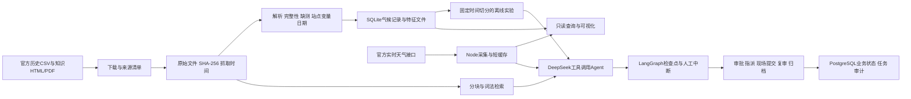

# RainGuard HK：AI数据开发岗位面试演示

日期：2026年10月20日。主平台：http://127.0.0.1:8100/ 。

## 先记住这一句话

**这是一个以香港官方天气数据为基础，把数据采集、质量校验、历史实验、可追溯检索和人工审批连接起来的运营应用原型。**

介绍时以数据开发链路为主线，天气是业务场景。它不是自研天气数值预报系统，也没有真实物业水浸标签。

## 两分钟介绍稿

> 这个项目叫RainGuard HK，面向天气信息影响下的物业值守、户外作业等运营核对场景。我会把它分成数据、智能和业务流程三层介绍。
>
> 数据层对接香港天文台等官方公开来源，保留原始文件、来源URL、抓取时间和SHA-256校验值，再解析成可查询的日气象记录。目前两个本地数据包合计约187万条日记录，覆盖175个站点变量系列；实时观测另外接入8类天气接口。数据有新鲜度、缺测和完整性标记，不能用旧快照冒充实时情况。
>
> 智能层包含两部分：一部分是按时间切分的历史降雨分类实验，另一部分是基于44份官方资料、370个片段的RAG和工具调用Agent。当前检索采用中英粤同义词扩展加BM25风格词法排序，没有使用向量数据库。Agent可以检索来源、比较地区、查询历史记录、读取实验结果和核对数据健康，但不能自行批准业务行动。
>
> 流程层用FastAPI、PostgreSQL和LangGraph实现持久化执行。模型分析后停在人工审批节点，随后才是指派、现场提交、独立复审和归档，过程中保留版本与审计记录，并支持重试和检查点恢复。
>
> 我认为它体现的数据开发能力，是从真实数据的可追溯接入到质量约束、SQL查询、可解释实验，再到把大模型放进受约束、可恢复的应用流程中。当前它仍是单组织应用原型，吞吐、检索质量和生产高可用需要进一步评估。

请根据自己实际参与的工作调整个人贡献表述，不把整个小组的工作或AI辅助生成的部分笼统说成独立完成。

## 五分钟演示路线

| 时间 | 页面与操作 | 重点讲什么 |
|---|---|---|
| 0:00–0:40 | 主平台「营运总览」 | 官方观测、来源状态、HKT时间；区分实测、预报与快照 |
| 0:40–1:20 | 「资料来源中心」 | URL、观测时间、抓取时间、SHA-256；接口成功不等于数据新鲜 |
| 1:20–2:00 | 「数据工作台」选择CCH、TEMP、2025，查询并导出CSV | 参数化SQL、只读数据库、质量标记、365条真实日记录 |
| 2:00–2:40 | 「官方知识库」搜索rainstorm或落大雨，切换原文语言 | 中英粤同义词、词法排序、原文片段、引用出处与收藏导出 |
| 2:40–3:30 | 「智能助手」查看已验证的真实知识库核验回答 | 真正的模型→工具→模型调用；44份/370片段来自工具返回，不由模型猜测 |
| 3:30–4:40 | 独立演练库企业页面，打开待审批流程 | Agent执行后中断；谁能审批、谁负责执行；历史快照与演练设施明确标记 |
| 4:40–5:00 | 查看归档示例、审计时间线 | 持久化状态、角色边界、版本冲突、失败重试；回到数据与业务责任链 |

主平台：http://127.0.0.1:8100/ 。正式企业入口：http://127.0.0.1:8100/enterprise/ 。

独立演练入口：http://localhost:8110/enterprise/ 。这是隔离SQLite演练库，使用真实官方资料和明确标示的历史快照；其中的账号、设施名称及现场文字仅用于演练。正式数据库不放入演练事故。

本机专用浏览器准备三个标签页：实时总览、已验证的真实助手回答、隔离企业流程。演练账号密码仅保存在本机`runtime/interview-2026-10-20/演练登录信息_勿共享.txt`，不要屏幕共享此文件或包含API密钥的环境配置文件。

如果现场网络不稳定，切换「真实下载快照」并明确说明是历史数据，结合演示包中的实测截图讲解。不要把旧快照说成当前天气。已归档的流程实例可用于讲解，不必在面试现场重新运行全部测试。

## 架构与数据流

网页使用原生JavaScript和Leaflet；天气及工具服务是Node；企业API是Python/FastAPI；业务和持久化检查点使用PostgreSQL；离线数据使用SQLite与文件。Docker Compose组织本机服务。没有在此项目中使用React、Spark、Flink、Milvus或Dify，不要误报技术栈。

## 与截图岗位职责对应

| 岗位方向 | 可以展示的实际工作 | 不宜扩大成什么 |
|---|---|---|
| 数据资产建设 | 原始文件、标准化记录、来源清单、日气象库与特征文件 | 生产级实时数仓或海量分布式平台 |
| 数据质量与工具链 | schema检查、缺测/完整性标记、时间检查、SHA-256、SQL过滤与测试 | 完整的数据治理产品或准确率已量化的AI质检 |
| BI、分析与可视化 | 地区对比、历史曲线、实验结果、CSV与交班报告 | 真实设施水浸概率、经济损失预测 |
| 大模型应用 | RAG、8个允许工具、调用轨迹、引用、人工审批、失败恢复 | 任意Text-to-SQL、自治多Agent团队或自动安全决策 |
| 数据库与SQL | SQLite参数化只读查询、PostgreSQL事务、版本控制与任务状态 | 已完成所有性能压测、SSO、多租户与高可用 |
| AI数据开发经验 | 把确定性规则、真实查询与LLM解释组合，验证错误边界 | 用Prompt替代所有数据校验 |

## 常见追问与回答要点

**1. 为什么做这个，已有天气应用不是很多吗？**

公共天气服务解决天气信息发布。本项目关注信息如何进入团队核对流程：真实来源能否追溯，数据过期如何阻断，谁审批、谁执行、如何复核和交班。现阶段是课程和工程原型，不宣称已有实际企业客户。

**2. 约187万条记录从哪里来？怎么确认不是重复拼出来的？**

本机基础库671,724条，扩展库1,199,668条，合计1,871,392条。两库分别有40和135个站点变量系列，本次检查系列交集为0。原始文件保留来源和哈希；数量是日气象记录总数，不是模型训练样本数，也不是事故数量。

**3. 数据新鲜度与数据完整性有什么区别？**

HTTP 200表示请求成功，新鲜度需要按官方观测时间及接口更新节奏检查；抓取到一份旧数据不意味着观测是新的。完整性标记和空值表达记录质量；查询分页截断则是展示限制，不能当成缺失数据。

**4. 为什么用SQLite和PostgreSQL两种库？**

离线气候数据以读取、复现和分发为主，SQLite部署简单且可只读挂载；企业流程存在账号、并发状态变化、任务和检查点，采用PostgreSQL事务及锁。当前规模适合这套组合，但未以压测证明生产容量上限。

**5. 为什么没有直接上向量数据库？这还算RAG吗？**

RAG是先检索证据再生成回答的流程，并不限定向量检索。当前小型官方语料采用分词/中文双字项、同义词扩展和BM25风格排序，便于解释和离线部署。下一步应先标注查询集，比较Recall@k、MRR等，再决定是否用向量与混合检索；尚未宣称这些指标已测得。

**6. Agent与普通聊天有什么区别？**

模型可以选择允许工具，服务端执行真实查询后将结果交回模型，并保留轨迹。允许工具共有8个：知识检索、地区比较、历史记录、实验结果、天气窗口、复核草稿、知识库覆盖、来源健康。工具名和参数经过校验，不允许任意脚本或任意外部写入。

**7. 怎么保证LLM不幻觉？**

不能保证零幻觉。通过真实工具、明确来源、结构化分页/时间范围、过期数据标记和人工审批来减少风险。当前引用检查主要核对编号及数据时效，不是事实准确率评价。面试前实测发现过“把top-10截断误认为缺测”的解释错误，因此补充了returnedCount、hasMore、nextOffset、日期边界说明及回归测试。

**8. 崩溃之后怎么恢复，会不会重复执行？**

LangGraph保存检查点，工作节点与人工中断可以恢复；业务队列有任务领取、租约、失败重试与死信，业务状态用版本号和持久化命令标识限制重复推进。外部模型请求可能重复或再次计费，不宣称外部请求恰好执行一次。演练实测包含失败任务人工重试后恢复。

**9. 模型效果如何？**

目标是“次日站点日雨量≥25mm”的课程分类。训练2000–2019、验证2020–2022、测试2023–2025，阈值按验证集F1选择，不能在测试集上挑阈值。沙田exclude策略下，逻辑回归测试ROC-AUC约0.860、AP约0.326；随机森林约0.867、AP约0.322。复杂模型并非所有指标都更好。不把这些结果称为洪水预测或今天实时预测。

**10. 会不会数据泄漏？**

特征只用目标日前的雨量滞后/过去7日汇总和日历季节项，时间切分独立；标准化在训练集拟合，阈值在验证集选。数据包保留哈希便于复核。并未报告跨地域泛化、统计显著性或现场业务收益。

**11. 做过Text-to-SQL吗？**

当前做的是允许工具加固定参数化SQL，历史数据库只读，没有让LLM直接执行任意生成SQL。如果扩展，会先限制只读账号、表与列白名单、SELECT语法树、行数、超时和审计，再做评测；这是下一步，不是已上线能力。

**12. 哪个问题最能体现你的数据开发思路？**

可以讲本次验证发现的两个具体问题：分页与缺失语义混淆，及本机代理导致内部HTTP请求失败。前者通过结构化工具契约和回归断言修复，后者对固定内部连接关闭环境代理，并验证死信任务恢复。重点讲定位证据、修改边界和验证结果，不只讲“接了一个大模型”。

**13. 下一步最值得做什么？**

先补检索/回答的标注评测集、持续数据质量报告与性能基准，再评估混合检索及受约束Text-to-SQL。若真实团队使用，再考虑多租户、SSO、监控告警、高可用、恢复演练和运维责任；不要为了技术名词先堆组件。

## 面试前最后一分钟

1. 确认Docker和主平台仍运行；先打开主平台总览看来源时间。
2. 检查已准备的三个浏览器标签，不展示API环境文件和私人登录说明。
3. 先讲数据链路，再讲Agent，最后讲审批；全程控制在5分钟左右。
4. 区分约187万数据记录、44份资料、370片段、8个工具、12个页面及模型训练样本数。
5. 若被追问个人分工、开发辅助方式与未实现能力，据实回答。

完整验证结果、今天的截图和离线材料位于工作区上一级`面试演示包_2026-10-20`。敏感登录信息不在公开演示压缩包中。

## 下午优先使用的已准备状态

专用浏览器第三个标签页已经登录隔离演练管理员，并打开真实DeepSeek流程的待审批页面。此流程已验证死信人工重试、人工退回后重新取证；当前最新取证成功。第一个标签展示实时数据，第二个标签保留真实网页对话。

完整验证不等于回答准确率评测。网页实测回答曾把知识库统计关联到天气引用`[local]`，该引用语义不支持统计结论；数字44/370可在实际`knowledge_inventory`轨迹中核对。下午演示时以工具原始结果和第三标签页的核对草稿为主，不把引用编号存在说成语义已验证。当前引用检查仍需进一步完善。

实时接口实测期间，临近预报曾返回502，其余来源仍可用。即使稍后恢复，也应保留这条运行事实，并说明快照降级和阻止过期作业建议的设计。面试时无需反复等待这个接口，按既定数据、知识和审批路线演示即可。
