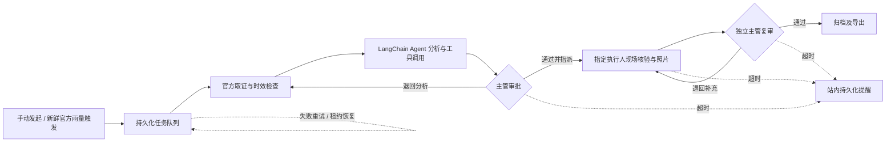

# RainGuard 企业工作流 · v0.5

本地 Docker + LangChain/LangGraph + FastAPI + PostgreSQL，复用现有香港官方数据、知识检索和历史实验工具。网页和微信小程序操作同一份企业流程。

## 立即使用

控制台：**http://127.0.0.1:8100**；天气工作台：**http://127.0.0.1:8096**。

在仓库根目录执行：

```powershell
python enterprise/bootstrap.py
docker compose --env-file runtime/enterprise.env -f compose.enterprise.yml up -d --build --wait
```

也可运行本目录的 `启动企业工作流.ps1`。初次自动生成管理员 `admin` 和高强度密码，登录信息只保存在本机 **runtime/enterprise.env**，不会打印到聊天或提交到 Git。已有配置不覆盖；管理员可在控制台修改密码，修改后此文件中的初始密码不再有效。

默认只监听本机，首次没有虚构设施、事故、现场照片或业务流程。没有配置模型时，来源核验模式仍可跑完整人工流程；它明确标示未调用语言模型。

## 启用真实 DeepSeek Agent

本机已按用户授权配置并验证DeepSeek；公开源码和压缩包不包含密钥。其他电脑可运行 `python enterprise/configure_model.py` 隐藏输入密钥，或在本机 `runtime/enterprise.env` 填入 `DEEPSEEK_API_KEY` 和适用的 `DEEPSEEK_MODEL`，然后重新执行上面的 `docker compose ... up -d`。密钥仅进入后端容器环境，小程序和网页只获取“是否已配置”的状态，不接收密钥。首次初始化会复用已有 `.env.local` 内的 DeepSeek 配置（如果存在）；不会从聊天或其他应用数据库提取密钥。

启用后在创建流程时选择“DeepSeek 工具调用 Agent”。当前采用官方支持的非思考模式，以控制单次时延和调用预算。LangChain 模型可自主选择六个允许工具；每次分析最多4轮模型请求、8次模型工具调用，前置另有3项固定取证。失败进入持久化重试与死信状态，不能拿模板文本冒充模型回答。工具只有查询及草稿能力，业务批准、指派、现场提交与归档仍由角色校验控制。

## 完整工作流



1. 管理员创建真实组员账号，并按实际工作分配主管、执行人、审计员。
2. 发起人填写真实设施、地区及问题，选择在线来源或真实历史快照。
3. 后台取证、分析，在 LangGraph 审批节点暂停，状态写入检查点。
4. 另一位主管审批并指派有效执行人，也可退回重新取证。创建者不能审批自己创建的流程。
5. 被指派人核对来源时间、实际现场和后续安排，填写事实、上传照片后提交。主管可记录原因后重新指派，原执行人随即失去提交权限。
6. 主管复审，可退回现场补充；复审者必须不同于创建者和执行人。通过后归档，保留证据、操作人、时间线和附件哈希。

“独立复审”指与创建者/执行人分离，不强制与初审主管不同。最少可用管理员主管与一位执行人协作：执行人发起，管理员审批并复审。若管理员自己发起，须另建主管账号审批和复审。站内通知不自动发往微信、邮件或其他外部渠道。

## 运行组件与可靠性

| 组件 | 职责 |
|---|---|
| weather | 现有 Node 天气服务、真实资料、受内部令牌保护的六种工具 |
| api | 独立账号、会话、角色和版本检查、流程/附件/审计接口、控制台 |
| worker | 持久化队列、租约与心跳、LangGraph 执行、暂停与恢复 |
| scheduler | 每5分钟检查规则；每30秒扫描1小时阶段超时 |
| database | PostgreSQL 业务记录、任务、站内通知、LangGraph 检查点 |

- 队列采用租约、心跳及过期回收；最多自动尝试3次，之后进入死信，可由主管修复配置后手动重试。
- PostgreSQL 行锁负责认领，流程级 advisory lock 防止同一流程并行改写检查点；命令ID避免同一恢复命令重复推进业务阶段。
- `revision` 乐观锁拒绝过期审批；审批事件、状态更新和站内通知一起事务提交。
- 模型和只读工具调用在崩溃恢复后可能重放，不能承诺外部模型请求恰好一次，重放可能产生模型费用；业务阶段通过持久化命令ID防止重复推进。
- 自动规则只接受标记为在线、未过期、有数值的官方地区观测；同一规则与观测时间只创建一次流程。缺失来源不会补零或模拟触发。
- PostgreSQL 与照片使用独立 Docker 卷，普通重启保留资料。不要使用 `down -v`，那会删除业务数据。

## 权限与数据

管理员管理成员；主管审批、重指派、复审和配置规则；执行人仅提交指派给自己的现场核验；审计员只读。账号停用立即撤销会话。Web 使用 HttpOnly / SameSite Cookie，小程序使用仅驻留内存的可撤销不透明令牌；密码使用带随机盐的 scrypt。跨站写入被拒绝，登录错误限次，JSON/照片限制大小，下载照片校验 SHA256。

当前是**单组织部署**，所有已登录成员可读取本组织流程；还没有企业SSO、多租户隔离或第三方审计认证。审计为应用层追加记录，不是不可篡改的合规存证。当前版本适用于课程展示与受控团队试用，不能仅凭这些检查宣称已经通过生产安全评估。

企业记录以 PostgreSQL 为准。旧版个人工作台保持独立，不自动将个人草稿伪装为企业审批记录；使用网页版入口“企业审批工作流”或小程序“工作台 → 进入企业审批工作流”办理团队流程。

## 小程序与团队访问

小程序新增企业流程页：登录、发起、审批指派、现场照片、提交、复审、重试、审计时间线。主管重指派也可在网页版办理。小程序令牌仅在当前运行内存里保存，重启需重新登录；正式真机仍需自己的 AppID 和 HTTPS request / uploadFile 合法域名。小程序的完整模拟器/真机验收仍受之前本机开发者工具空白窗口问题影响，不能用网页截图替代。

局域网访问时，在 `runtime/enterprise.env` 设置 `WORKFLOW_BIND_ADDRESS=0.0.0.0`，重新运行 Compose；组员使用这台电脑的实际局域网 IP。正式 HTTPS 反向代理需设置 `WORKFLOW_PUBLIC_ORIGIN=https://实际域名` 与 `SECURE_COOKIES=true`，并按实际入口设置 `WORKFLOW_PUBLIC_URL`。这些配置均不应公开数据库或内部工具令牌。

## 运维与备份

```powershell
docker compose --env-file runtime/enterprise.env -f compose.enterprise.yml ps
docker compose --env-file runtime/enterprise.env -f compose.enterprise.yml logs --tail 50 worker api
python enterprise/backup.py
```

备份脚本短暂停止本项目的 API、执行器和调度器，导出 PostgreSQL 自定义格式与照片卷，生成 SHA256 清单后重新启动；文件保存在忽略提交的 `runtime/backups`。恢复应先停写，校验清单，再用 `pg_restore` 恢复到空数据库并恢复对应照片卷；先在隔离环境验证，勿直接覆盖仍在使用的库。管理员密码文件、备份和现场照片不要放到公开仓库。

## 验证与依据

```powershell
.venv/Scripts/python.exe -m pytest enterprise/tests -q
node test-workflow-bridge.mjs
docker compose --env-file runtime/enterprise.env -f compose.enterprise.yml exec -T api python -m enterprise.container_check
```

浏览器验收先运行 `scripts/enterprise_qa.py`，再运行 `node scripts/enterprise_browser_check.mjs`。测试使用独立 SQLite 或专用临时 PostgreSQL 数据库，真实知识/快照来自原项目；合成用户和现场文字仅在隔离库中，不写入正式业务库。详见 [验收记录](验收记录.md)。

框架依据：[LangGraph 人工暂停与恢复](https://docs.langchain.com/oss/python/langgraph/interrupts)、[持久化检查点](https://docs.langchain.com/oss/python/langgraph/persistence)、[LangChain DeepSeek 集成](https://docs.langchain.com/oss/python/integrations/chat/deepseek)、[Docker 健康依赖启动](https://docs.docker.com/compose/how-tos/startup-order)、[DeepSeek思考模式参数](https://api-docs.deepseek.com/guides/thinking_mode/)。
